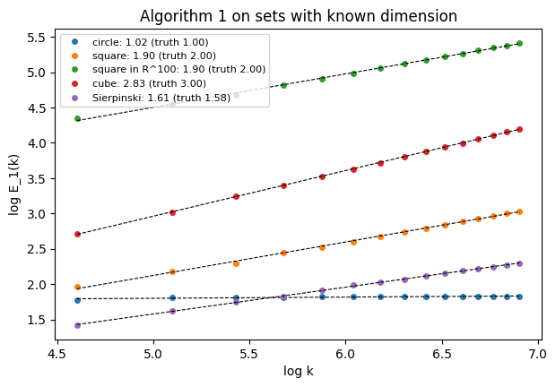
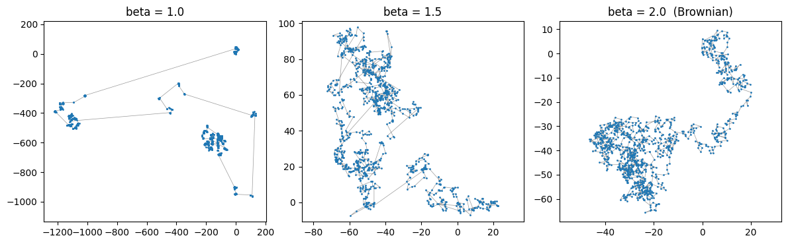
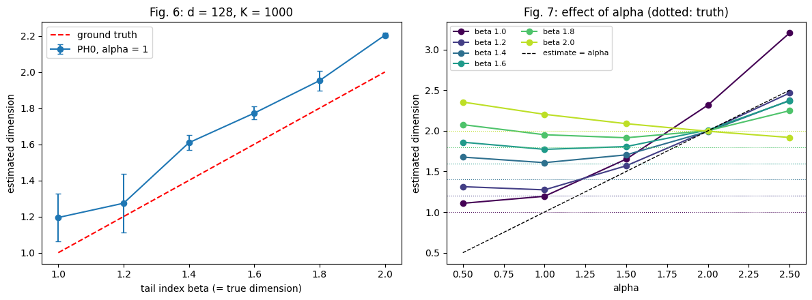
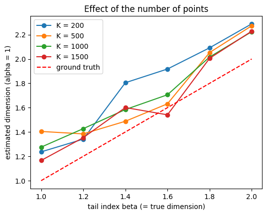

# phdim-generalization

[](https://github.com/mahird3/phdim-generalization/actions/workflows/tests.yml)

This repository contains my implementation of the PH⁰ dimension estimator (Algorithm 1) from

> T. Birdal, A. Lou, L. Guibas, U. Şimşekli. *Intrinsic Dimension, Persistent Homology and Generalization in Neural Networks.* NeurIPS 2021. [arXiv:2111.13171](https://arxiv.org/abs/2111.13171)

together with checks on point clouds whose dimension is known. The official code is [here](https://github.com/tolgabirdal/PHDimGeneralization).

## Background

The paper bounds the generalization gap of a network by the intrinsic dimension of the set of weights visited by SGD near a minimum. This dimension equals the PH⁰ dimension, which can be estimated from samples. The finite PH⁰ lifetimes of a point cloud are the edge lengths of its minimum spanning tree (MST), and for $k$ points drawn from a set of dimension $D$,

$$E_\alpha(k) = \sum_{e \in \mathrm{MST}} |e|^\alpha \;\sim\; k^{\,1-\alpha/D}.$$

Fitting the slope $m$ of $\log E_\alpha(k)$ against $\log k$ then gives $D = \alpha/(1-m)$. In practice the distance matrix is computed once, and the rest only works on this $K \times K$ matrix, so the number of parameters only matters in the first step.

## Usage

```bash
pip install -e ".[test]"
pytest
```

```python
import numpy as np
from phdim import ph_dim, distance_matrix, levy_path

X = np.random.default_rng(0).random((1000, 2))   # uniform points in a square
ph_dim(X)                                         # about 1.9

D = distance_matrix(levy_path(1000, 128, 1.5, np.random.default_rng(0)))
ph_dim(D=D, alpha=1.0)                            # the distance matrix can be reused for other alphas
```

The package has three modules: `estimator.py` (distance matrix, MST lifetimes, Algorithm 1), `levy.py` (isotropic β-stable Lévy paths) and `shapes.py` (circle, cube, Sierpinski triangle, random linear embedding). The figures below come from [`notebooks/validation.ipynb`](notebooks/validation.ipynb).

## Validation

### Sets of known dimension

1000 points per set, α = 1.

| Set | Dimension | Estimate |
|---|---|---|
| circle | 1 | 1.02 |
| square | 2 | 1.90 |
| square embedded in $\mathbb R^{100}$ | 2 | 1.90 |
| cube | 3 | 2.83 |
| Sierpinski triangle | 1.585 | 1.61 |



The embedded square gives the same value as the planar one, so the estimate depends on the intrinsic dimension and not on the ambient one. Filled sets are slightly underestimated at this sample size, mostly because of boundary effects. I also checked that the MST edge lengths coincide with the H⁰ deaths returned by Ripser.

### β-stable Lévy paths

The trajectory of a β-stable Lévy process has dimension β (Blumenthal and Getoor, 1960), so it provides a ground truth close to the heavy-tailed behaviour of SGD. Smaller β means more small steps and a few large jumps, which gives clustered paths and a lower dimension. Following Section 5.2 of the paper, I used paths of 1000 points in $\mathbb R^{128}$, with 3 paths per value of β.



| β | 1.0 | 1.2 | 1.4 | 1.6 | 1.8 | 2.0 |
|---|---|---|---|---|---|---|
| estimate | 1.19 ± 0.13 | 1.27 ± 0.16 | 1.61 ± 0.04 | 1.77 ± 0.04 | 1.95 ± 0.06 | 2.20 ± 0.01 |



The estimate follows β with a small upward bias, as reported in the paper (Fig. 6). β = 1 is the noisiest case: there α = 1 equals the true dimension, and the steps have infinite mean. The right panel reproduces Fig. 7: once α is larger than the dimension, the large jumps dominate $E_\alpha$ for every $k$, the slope goes to zero and the estimate is simply α. This is why α has to stay below the dimension.

With fewer points the estimate gets noisier. At $K = 200$, the number of iterates used for small networks in the paper, it still increases with β but is biased upward by 0.1 to 0.3, so it seems more reliable for comparing trajectories than as an absolute value.



## Tests

The tests in `tests/` (23 in total, run on every push) cover the distance matrix and MST lifetimes on small hand-computed examples, the comparison with Ripser, the known dimensions above, the distribution of the Lévy sampler (characteristic function, Cauchy case), and the two Lévy experiments.

## Next steps

I am currently working on the experiments with trained networks (fcn-5 on MNIST, varying learning rate and batch size), to look at the correlation between the PH dimension and the generalization gap. One question I want to look at is how much of this correlation is explained by the ratio of learning rate to batch size alone.
